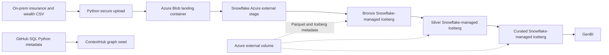

# ContextHub Insurance + Wealth Lakehouse (Synthetic Reference)

**Not a MassMutual product or dataset.** Fictional MassMutual-*inspired* domain examples for a technical demo. All records are synthetic, and model semantics are illustrative rather than actuarial/accounting advice.

## Architecture



**Important separation:** Azure landing files are plain CSV, not Iceberg tables. Snowflake creates and manages the Iceberg tables (`CATALOG='SNOWFLAKE'`) while an Azure **external volume** stores table data and metadata in a distinct container. The Azure **storage integration + external stage** reads CSV. Both Azure resources require separate Entra consent/RBAC configuration.

## Quick start (local: no cloud credentials required)

```bash
python -m pip install -r requirements.txt
export PYTHONPATH=src  # PowerShell: $env:PYTHONPATH='src'
python -m mm_lakehouse.cli generate --customers 100
python -m mm_lakehouse.cli drift
python -m mm_lakehouse.cli graph
pytest -q
```

For cloud execution, create `.env` from `.env.example` and follow `docs/runbook.md` before running:

```bash
python -m mm_lakehouse.cli upload
python -m mm_lakehouse.cli bootstrap
python -m mm_lakehouse.cli run
```

**Cloud prerequisite:** first manually run the Azure integration and external-volume creation and consent steps in `sql/00_setup.sql`; the placeholders are intentionally commented out. You cannot bootstrap the external-volume tables until these steps succeed.

## Business domains

| Domain | Source entities | Curated assets |
|---|---|---|
| Life & protection | customer, insurance_product, policy, coverage | FACT_POLICY_PREMIUM, MONTHLY_PREMIUM_BY_PRODUCT |
| Wealth | advisor, wealth_account, holding, transaction | FACT_WEALTH_POSITION |

## ContextHub knowledge-graph crawling

Crawl this repository for source contracts (`src/mm_lakehouse/contracts.py`), SQL transformations (`sql/`), application calls (`src/`), orchestration metadata (`metadata/pipeline_catalog.yaml`), and architecture (`docs/architecture.mmd`). `graph` produces a normalized JSON graph seed of source files, tables, columns, SQL files and dependencies; connect SQL AST / runtime metadata to enrich into production-grade column-level lineage.

The repo intentionally separates **discovery**, **data modeling**, **transformation**, **schema drift**, **pipeline execution**, and **QA** artifacts so specialized digital workers can retrieve and reason over them independently.

## Repository structure

- `src/mm_lakehouse/generate.py`: deterministic fictional CSV datasets.
- `src/mm_lakehouse/azure.py`: Azure Blob upload and content-addressed naming.
- `src/mm_lakehouse/drift.py`: schema drift gates for CSV headers.
- `src/mm_lakehouse/graph.py`: ContextHub graph-seed exporter.
- `sql/00_setup.sql`: Azure integration/volume templates, database schemas, CSV file format.
- `sql/01_tables.sql`: Bronze/Silver/Curated Snowflake-managed Iceberg DDL.
- `sql/02_bronze_load.sql`: staged CSV to Bronze COPY.
- `sql/03_silver.sql`: deduplicating upsert transformations.
- `sql/04_curated.sql`: insurance and wealth Gold transformations.
- `sql/05_quality.sql`: warehouse assertions.
- `.github/workflows/ci.yml`: static and Python CI.

## Constraints

Cloud infrastructure and permissions cannot be provisioned automatically by this repository. No real MassMutual data, system names, credentials or internal schemas are included. Production use needs privacy controls, IAM hardening, end-to-end orchestration, typed error/quarantine handling, CDC/delete semantics, source-specific ingestion SLAs, robust SQL lineage and integration tests in your own Snowflake account.

## Documentation

See [runbook](docs/runbook.md), [architecture](docs/architecture.mmd), and [graph model](docs/graph_model.md).
